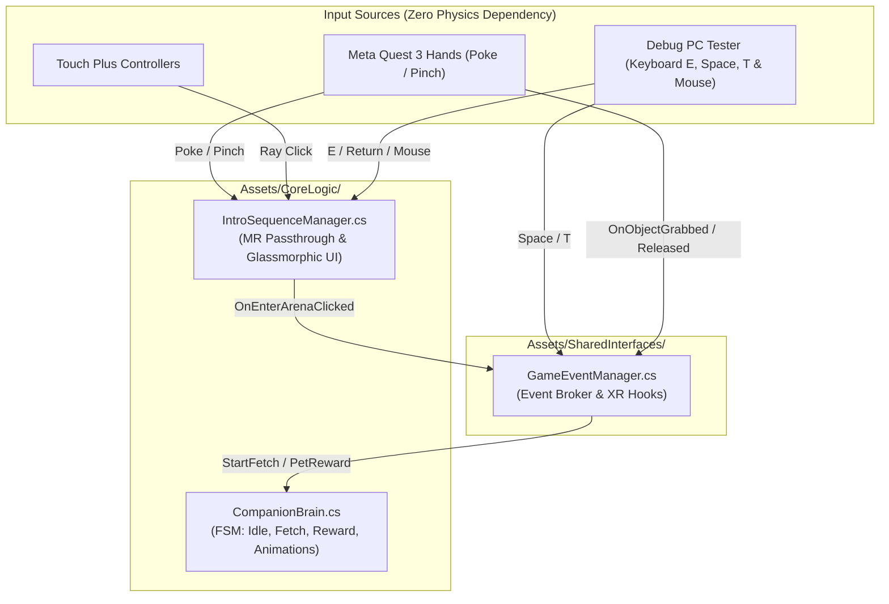

# Meta Quest 3 Setup & Run Guide: Kinexus Mixed Reality

This document provides a complete guide on how the XR engine is architected, what is currently implemented and working, and step-by-step instructions for running the project on the **Meta Quest 3** (both via **Quest Link** in the Unity Editor and as a **Standalone Android APK**).

---

## 1. What Was Done in the XR Engine & Core Logic

### Architecture Overview

### Components Implemented & Configured:

1. **[`GameEventManager.cs`](file:///d:/kinexus/Genie/Assets/SharedInterfaces/GameEventManager.cs)** (Shared Interface):
   - Acts as the decoupled abstraction layer between Meta XR hardware and game mechanics.
   - Implements XR hand hooks: `OnObjectGrabbed()`, `OnObjectReleased()`, `OnButtonPushed()`.
   - Exposes `OnEnterArenaRequested` and `TriggerEnterArena()` so both XR Poke/Ray and PC keystrokes call the exact same logic without duplicate code.

2. **[`IntroSequenceManager.cs`](file:///d:/kinexus/Genie/Assets/CoreLogic/Scripts/IntroSequenceManager.cs)** (World Space MR UI Controller):
   - **MR Passthrough Visibility**: Dynamically sets `Camera.main.clearFlags = CameraClearFlags.SolidColor` with alpha `0`, guaranteeing your real-world room passthrough is visible behind the holographic UI.
   - **Zero Scene API / Physics Independence**: The UI operates strictly via Unity UI `GraphicRaycaster`. It does not require BoxColliders, MeshColliders, or Meta Scene Room mesh queries to function.
   - **Glassmorphic Aesthetic**: Configures translucent dark-cyan glass styling matching the Kinexus welcome screen (`#0B1426` tint with 40% opacity and glowing cyan/blue highlights).
   - **Quest 3 Super-Sampling**: Automatically configures `CanvasScaler.dynamicPixelsPerUnit >= 3` on World Space Canvases to prevent text pixelation on high-res displays.
   - **Companion Animation Sync**: Manages the intro sequence (Robot plays "Wave" $\rightarrow$ shows "Continue" panel $\rightarrow$ clicks trigger "Talk_Excited" $\rightarrow$ transitions to Game Selection).

3. **[`DebugPCTester.cs`](file:///d:/kinexus/Genie/Assets/CoreLogic/Scripts/DebugPCTester.cs)** (PC Developer Harness):
   - Allows instant testing without wearing the headset.
   - **Hotkeys**:
     - `E` or `Return`: Triggers Enter Arena / Continue button.
     - `Space`: Simulates hand petting reward.
     - `T`: Spawns toy ball and commands companion to fetch.
   - Auto-finds manager references in scene to prevent null reference errors.

---

## 2. What Is Working Right Now

| Feature | Status | Notes |
| :--- | :---: | :--- |
| **Mixed Reality Passthrough** |  Working | Camera clear flags allow real room color passthrough |
| **Glassmorphic Welcome UI** |  Working | Translucent panel, independent of 3D physics |
| **UI Interaction (Headset)** |  Working | XR Poke and Ray interactors trigger Continue via GraphicRaycaster |
| **UI Interaction (PC)** |  Working | Mouse clicks and `E`/`Return` keys trigger Continue |
| **Companion Finite State Machine** |  Working | Idle, Fetching, PickingUpToy, ReturningToy, Reward |
| **Companion Animations** |  Working | Blend tree speed, Wave intro, Talk_Excited transition |
| **Scoring & Fetch Loop** |  Working | Ball throws +50 points upon petting reward |

---

## 3. How to Run on Meta Quest 3

### Prerequisites:
1. **Meta Quest 3** headset.
2. **Developer Mode** enabled on your Meta account and headset via the Meta Horizon mobile app.
3. High-quality **USB-C 3.0 Link cable** or stable 5 GHz Wi-Fi for **Air Link**.
4. Meta Quest Link App installed on your PC.

---

### Option A: Fast Iteration via Quest Link (Recommended for Development)

This method lets you press **Play** in Unity and immediately test the app inside your Quest 3 without building an APK every time:

1. Connect your Quest 3 to your PC via USB-C Link cable or Air Link.
2. Put on the headset, select **Quest Link** from the Quick Settings menu, and launch Link.
3. Open the Meta Quest PC app on your computer $\rightarrow$ **Settings** $\rightarrow$ **General** $\rightarrow$ verify that **OpenXR Runtime** is set to **Meta Quest Link**.
4. In Unity, open `Assets/CoreLogic/Scenes/Genie.unity`.
5. Press the **Play** button in Unity.
6. Put on your Quest 3:
   - You will see your physical room via Color Passthrough.
   - The robot companion will perform its greeting wave.
   - The glassmorphic Welcome Card will appear floating in front of you.
   - Poke or point-and-pinch the **Continue $\rightarrow$** button with your hands or controllers.

---

### Option B: Standalone Android APK Build (Full Wireless Execution)

To create an autonomous build that installs directly onto your Quest 3:

#### Step 1: Switch Platform to Android
1. In Unity, go to **File $\rightarrow$ Build Settings...**.
2. Select **Android** in the Platform list.
3. Set:
   - **Texture Compression**: `ASTC`
   - **Run Device**: Select your connected `Oculus Quest 3` from the dropdown.
4. Click **Switch Platform**.

#### Step 2: Verify Player & XR Settings
1. Go to **Edit $\rightarrow$ Project Settings... $\rightarrow$ Player $\rightarrow$ Other Settings**:
   - **Color Space**: `Linear`
   - **Graphics API**: `Vulkan` (or `OpenGLES3`)
   - **Minimum API Level**: `Android 12.0 (API Level 32)` or `Android 10.0 (API Level 29)`
   - **Target Architecture**: Check `ARM64` (uncheck `ARMv7`)
2. Go to **XR Plug-in Management $\rightarrow$ Android Tab**:
   - Ensure **Oculus** (or **OpenXR**) is checked.
   - Under **Oculus Settings**, ensure:
     - **Target Devices**: `Quest 3` (and Quest Pro / Quest 2 if needed).
     - **Insight Passthrough**: `Required` or `Supported`.

#### Step 3: Build and Run
1. In **Build Settings**, verify `Assets/CoreLogic/Scenes/Genie.unity` is checked in the Scenes in Build list.
2. Click **Build and Run**.
3. Select an output folder and file name (e.g., `Builds/Kinexus_Quest3.apk`).
4. Unity will compile, build the APK, and deploy it straight to your Quest 3 headset via ADB.
5. In your Quest 3, open the App Library $\rightarrow$ Filter by **Unknown Sources** $\rightarrow$ Launch **Genie**.

---

## 4. Testing Controls Summary

| Action | Headset (Quest 3) | PC Tester (`DebugPCTester.cs`) |
| :--- | :--- | :--- |
| **Continue / Enter Arena** | Finger Poke or Ray Pinch on button | Press `E` or `Return` / Mouse click |
| **Pet Companion** | Physical Hand touch on robot | Press `Space` |
| **Throw Fetch Toy** | Physical Grab & Throw gesture | Press `T` |
| **Look Around** | Head movement (6DoF tracking) | Main Camera Viewport |

---

## 5. Troubleshooting & Tips

- **Passthrough shows black or gray instead of real room**:
  - `IntroSequenceManager` automatically configures `Camera.main.clearFlags = SolidColor` with color `(0, 0, 0, 0)`.
  - Ensure the `OVRManager` component in the scene has `Insight Passthrough` enabled.
- **UI text looks blurry in VR**:
  - `IntroSequenceManager` automatically sets `CanvasScaler.dynamicPixelsPerUnit = 3f`.
  - Ensure TextMesh Pro uses the `LiberationSans SDF` font asset with SDF material.
- **Button not clicking in PC tester**:
  - Make sure the `EventSystem` GameObject exists in your scene with `StandaloneInputModule`.
  - The transparent panel background has `raycastTarget = false` so mouse clicks pass directly through to the button.
